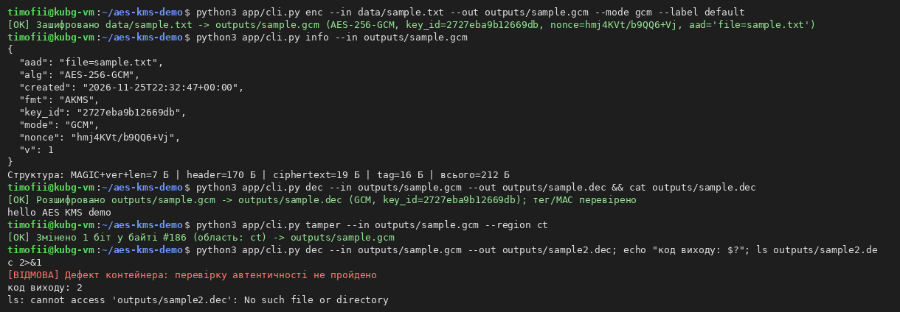

# СР №2. Безпечний модуль шифрування та управління ключами AES (aes-kms-demo)

Виконав: **Кондратюк Т.С.**, група 22340, Київський столичний університет імені Бориса Грінченка.

Модуль `kms/aes_kms.py` реалізує:
* **AES-256-GCM** (AEAD, NIST SP 800-38D) — режим за замовчуванням;
* **AES-256-CBC + HMAC-SHA256** (encrypt-then-MAC, окремі ключі через HKDF) — лише для сумісності;
* **ECB/CFB/OFB без автентифікації не підтримуються** (запит ECB → відмова);
* **KMS**: master-пароль → PBKDF2-HMAC-SHA256 (600 000 ітерацій, сіль 16 Б) → KEK → зашифровані (AES-GCM) робочі ключі AES-256;
* **ротацію** з версіонуванням: `active` → `retiring` (лише розшифрування, dual-read) → `disabled` після міграції;
* контейнер `AKMS v1` з автентифікованим JSON-заголовком, журнал nonce (повтор → відмова), ліміти використання ключа,
  уніфіковану помилку «дефект контейнера», журнал аудиту без секретів.

## Структура
```
kms/aes_kms.py          модуль: KeyStore (KMS) + контейнер + API encrypt/decrypt
app/cli.py              CLI: key new|rotate|list|disable|migrate, enc, dec, info, tamper, nonce-test
app/vault.py            простий застосунок «Захищений нотатник», що використовує модуль
tests/test_roundtrip.py 49 pytest-тестів (round-trip, tamper, пароль, nonce, ротація, політики, журнал)
tools/attack_tests.py   27 сценаріїв атак (усі мають завершитися відмовою)
tools/real_data_test.py тест на реальних файлах (TXT, JPEG, PDF, DOCX, .so 19/82 МБ) зі звіркою SHA-256
tools/ecb_demo.py       наочно: чому ECB небезпечний
tools/template_audit.py вади вихідного шаблону (original_template/), які виправлено
docs/screenshots/       скриншоти виконання
```

## Запуск
```bash
pip install -r requirements.txt
export AKMS_PASSWORD='ваш-master-пароль'        # або --password / інтерактивний ввід
python app/cli.py key new --label default
python app/cli.py enc --in data/sample.txt --out outputs/sample.gcm --mode gcm --label default
python app/cli.py dec --in outputs/sample.gcm --out outputs/sample.dec
python app/cli.py tamper --in outputs/sample.gcm   # dec після цього -> «Дефект контейнера»
python app/cli.py key rotate --label default       # нові дані — новим ключем, старі читаються старим
python app/cli.py key migrate --label default --in outputs/sample.gcm
python app/cli.py nonce-test --label default
pytest -q && python tools/attack_tests.py && python tools/real_data_test.py
```

## Формат контейнера AKMS v1
```
"AKMS"(4) | ver=1(1) | len(2, BE) | JSON-заголовок | ciphertext | tag 16 Б (GCM) / HMAC 32 Б (CBC-HMAC)
заголовок: {fmt, v, alg, mode, key_id, nonce|iv, aad, created[, mac]}
GCM: AAD = усі байти до кінця заголовка; CBC-HMAC: HMAC(mac_key, заголовок || ciphertext)
```

## Результати
| Перевірка | Результат |
|---|---|
| pytest | 49 passed |
| Сценарії атак | 27/27 заблоковано |
| Реальні файли | 7 файлів × 2 режими, SHA-256 збіглися 14/14 |
| bandit | 0 зауважень |


